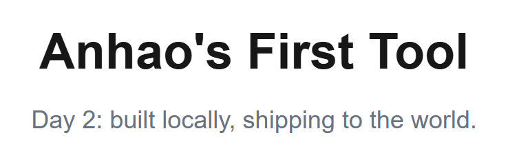

<div align="center">

# my-first-tool

**The first thing I ever built and shipped to the internet.**

<a href="https://my-first-tool-six.vercel.app"></a>
<a href="LICENSE"></a>




</div>

---

## What this is

**Day 2** of a [90-day challenge](https://github.com/anhaoXie/hello-micro-tools) to ship
something every single day.

The app itself is deliberately tiny — a heading and a subtitle. That was the point. The goal
of Day 2 was not to build a feature, it was to close the **whole loop** for the first time:

> write code → `npm run build` → push to GitHub → deploy on Vercel → get a public URL I could
> send to someone.

Everything after this day builds on that loop being real.

## Live

<https://my-first-tool-six.vercel.app>

## Tech stack

| Layer | Choice | Why |
| --- | --- | --- |
| Framework | Next.js 16 (App Router, Turbopack) | the current default; file-based routing kept the mental model small |
| UI | React 19 | comes with Next.js |
| Language | TypeScript 5 | catches mistakes before the build, not after the deploy |
| Styling | Tailwind CSS v4 | styling without leaving the JSX file |
| Hosting | Vercel | zero-config deploys straight from a GitHub push |

## Getting started

```bash
git clone https://github.com/anhaoXie/my-first-tool.git
cd my-first-tool
npm install
npm run dev
```

Open <http://localhost:3000>.

```bash
npm run build   # production build
npm run lint    # eslint
```

## Project structure

```
app/
  page.tsx        the entire UI — one component, one screen
  layout.tsx      root layout and metadata
  globals.css     Tailwind entry
docs/
  screenshot.png  the image at the top of this README
```

## What I actually learned

1. **A deployed URL is a different feeling from a local build.** `localhost:3000` proves the
   code runs; a public URL proves the thing exists.
2. **`create-next-app` gives you the plumbing for free**, so the only real work left is the
   part you actually wanted to build.
3. **Committing on a schedule forces progress.** This repo exists because Day 2 needed a
   commit.

## License

[MIT](LICENSE) © anhaoXie
